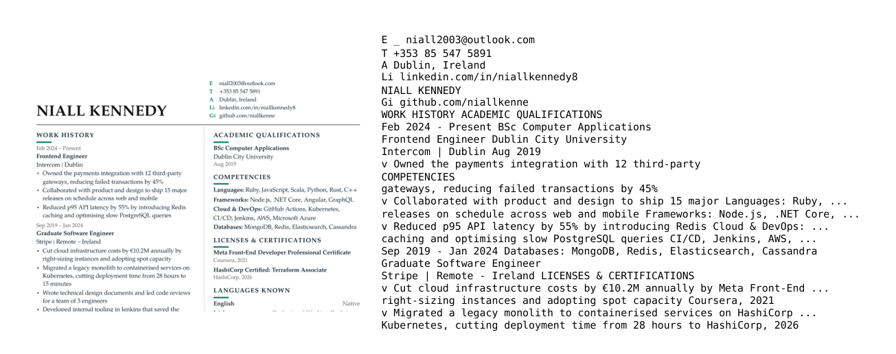
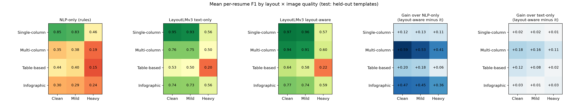
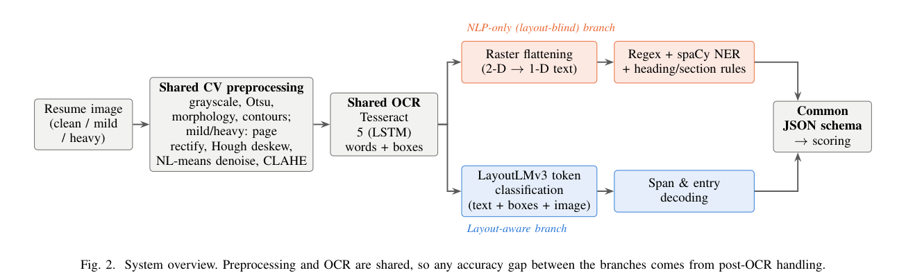
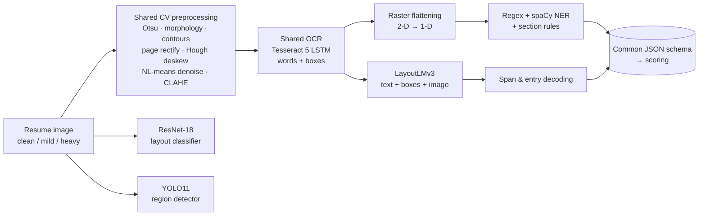
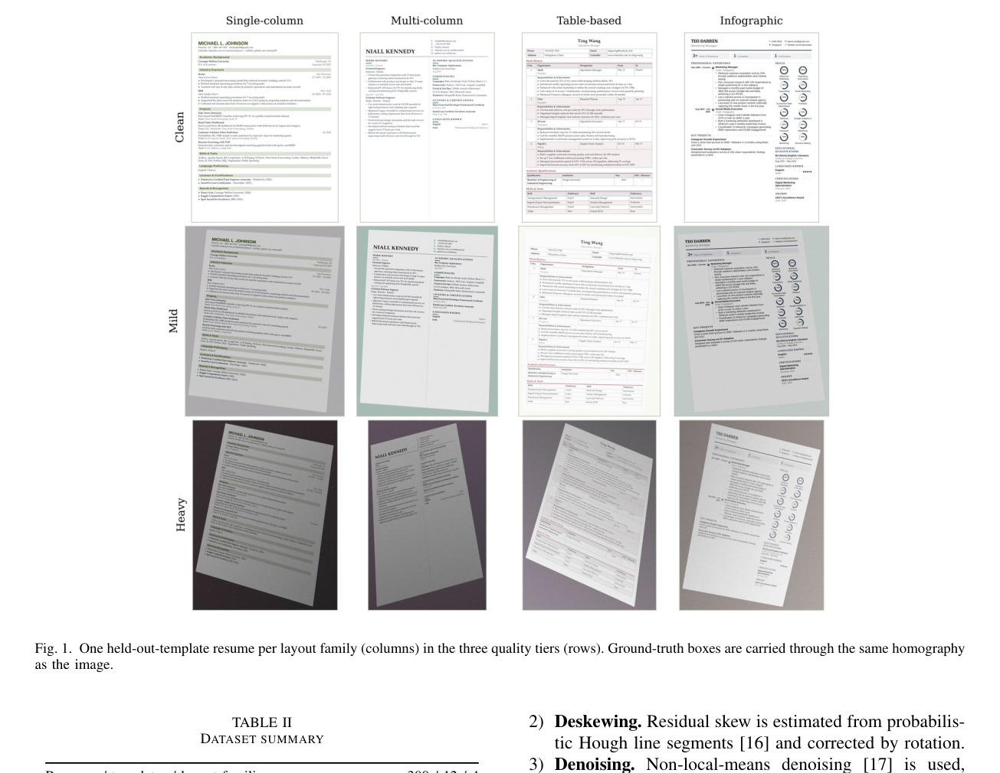
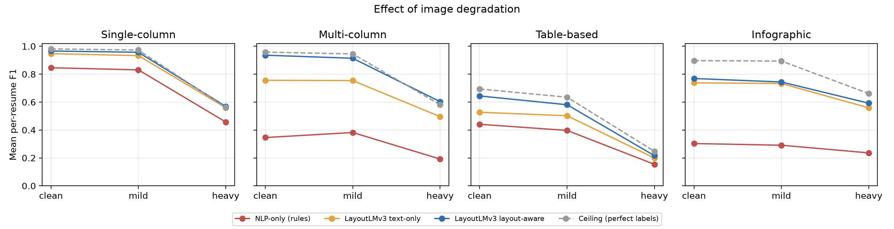
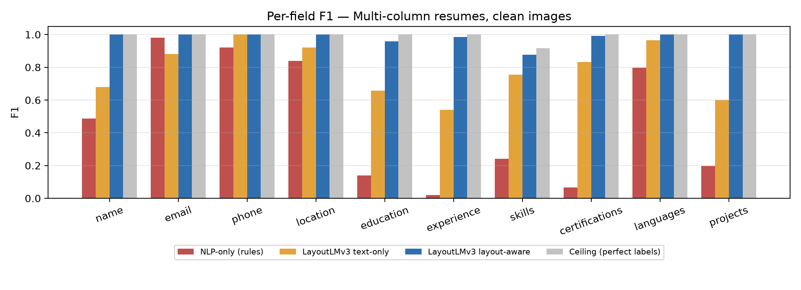
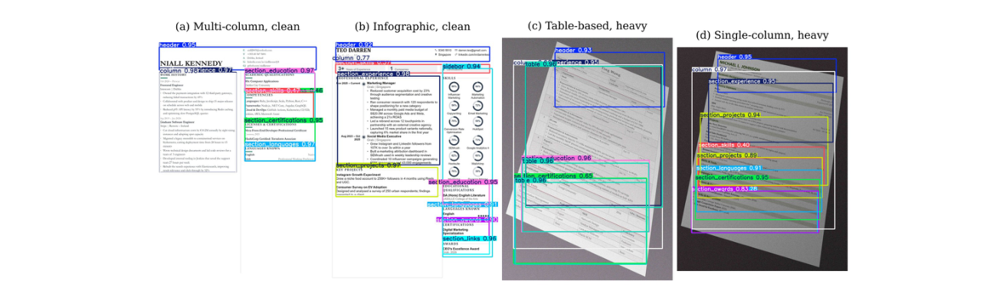
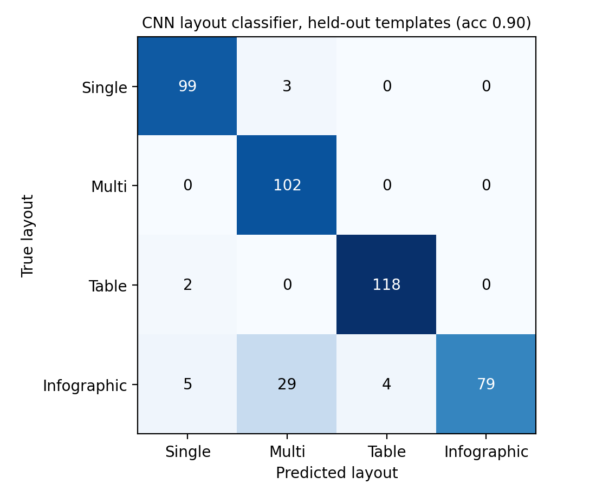
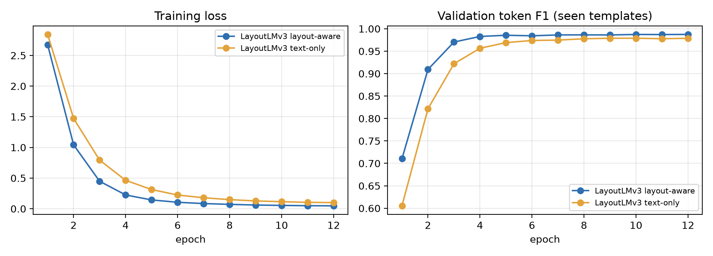

<div align="center">

# LayoutSense

### Layout-Aware Resume Parsing using LayoutLMv3, YOLO11, ResNet-18 & Tesseract OCR

*Does layout awareness matter for resume parsing? A controlled comparison across layout complexity and image quality.*

[](paper/Layout_Awareness_Resume_Parsing_Paper.pdf)


</div>

---

## Overview

Most resume parsers run OCR, **flatten the page into a single text stream**, and apply regex + NER rules. Flattening throws away the 2-D structure of the page, so on a two-column resume a job title from the left column ends up glued to a degree from the right column.

**LayoutSense** tests that claim under fully controlled conditions. Two parsers receive the **same images, the same CV preprocessing and the same OCR output**, and are scored against the **same exact ground truth**:

| | Pipeline | What it sees |
|---|---|---|
| 🅰️ | **NLP-only parser** (layout-blind) | Raster-flattened text → regex + spaCy NER + heading rules |
| 🅱️ | **LayoutLMv3** (layout-aware) | Words **+ bounding boxes + page image** → token classification |
| 🧪 | **Text-only LayoutLMv3** (ablation) | Same model, boxes zeroed and no image, to separate *learning* from *layout* |

It also adds a shared vision front end: a **ResNet-18 layout classifier** and a **YOLO11 region detector** for 14 page-region types.

<p align="center">
  
  <br/><em>Why flattening fails: raster-order OCR interleaves the columns, e.g. "Frontend Engineer Dublin City University".</em>
</p>

---

## Key Results

> All numbers are on **4 held-out templates the models never saw during training**: 25 resumes per layout × 3 quality tiers.

<div align="center">

| Metric | NLP-only | Text-only LayoutLMv3 | **Layout-aware LayoutLMv3** |
|---|:---:|:---:|:---:|
| **Mean F1 (all 12 layout × quality cells)** | 0.406 | 0.642 | **0.708** |
| Multi-column, clean | 0.346 | 0.756 | **0.936** |
| Single-column, clean | 0.846 | 0.947 | **0.966** |
| Table-based, clean | 0.441 | 0.527 | **0.644** |
| Infographic, clean | 0.303 | 0.738 | **0.769** |
| Parse time / resume (after OCR) | 0.05 s (CPU) | 0.47 s (T4) | 0.20 s (T4) |

</div>

- 🏆 **Layout-aware LayoutLMv3 wins all 12 cells** and beats the NLP-only parser **significantly in 12/12** (Wilcoxon signed-rank, Bonferroni α = 0.0042).
- 📈 **+0.30 mean F1** over the NLP-only baseline (**+74% relative**), up to **+0.59 F1** on clean multi-column resumes (0.346 → 0.936).
- 🧩 **Layout itself matters only where structure matters.** Layout-aware vs text-only is significant on **multi-column** (all tiers, +0.11 to +0.18) and **table-based** (clean/mild, +0.08 to +0.12) pages, but not on single-column or infographic pages.
- ⚖️ **About 78% of the total gain comes from learning and about 22% from layout.**
- 📉 **OCR is the bottleneck under heavy degradation.** Word accuracy drops to 0.59–0.69 and the layout advantage *shrinks* rather than grows.
- 👁️ **Page structure survives degradation; text does not.** The CNN and YOLO models are almost unaffected from clean to heavy images.

| Vision component | Result on unseen templates |
|---|---|
| **ResNet-18 layout classifier** | **90.2% accuracy**, macro-F1 0.899, 13 ms/page |
| **YOLO11-s region detector** | **0.731 mAP@50**, 0.641 mAP@50–95, 26 ms/page (val on seen templates: 0.972 mAP@50) |

<p align="center">
  
  <br/><em>Mean per-resume F1 for every layout × quality cell, plus the total gain and the layout-only gain.</em>
</p>

---

## System Architecture

<p align="center">
  
</p>



Because preprocessing and OCR are shared, **any accuracy gap between the branches comes only from what happens after OCR.**

---

## Features

- **🏭 Synthetic resume generator.** 12 Jinja2 HTML/CSS templates rendered at 300 DPI with headless Chromium. Realistic content from **50 regional profiles** and **20 industries**, fresher to executive, 1–2 pages, no placeholder data.
- **🎯 Pixel-exact ground truth.** Word boxes, BIO field labels and layout regions are read straight from the browser DOM, then carried through every degradation via a homography.
- **📸 Realistic scan/photo degradation.** Composite rotation, perspective warp, noise, blur, brightness/contrast, shadow and JPEG artefacts in 3 tiers.
- **🧹 Classical CV recovery chain.** Page detection, perspective rectification, Hough deskew, non-local-means denoising, illumination flattening and CLAHE.
- **🤖 Four models**: rule-based NLP parser, layout-aware LayoutLMv3, text-only LayoutLMv3 ablation, ResNet-18 classifier, YOLO11 detector.
- **📊 Rigorous evaluation.** Field-level fuzzy matching (RapidFuzz ≥ 90), per-resume micro-F1, paired Wilcoxon tests with Bonferroni correction, and an **OCR label ceiling** that separates OCR error from model error.
- **🖥️ Interactive Streamlit demo.** One resume, every model, side by side with the answer key across 7 tabs.

---

## Dataset

<p align="center">
  
  <br/><em>One held-out-template resume per layout family (columns) in the three quality tiers (rows).</em>
</p>

| Property | Value |
|---|---|
| Resumes / templates / layout families | 300 / 12 / 4 |
| Page images (3 tiers) | 1,278 |
| Train / val / test pages | 714 / 123 / 441 |
| Test resumes (unseen templates) | 100 (25 per layout) |
| Regional profiles / industries | 50 / 20 |
| Field types | 32 (65 BIO labels) |

**Layouts:** single-column · multi-column · table-based · infographic &nbsp;|&nbsp; **Quality tiers:** clean · mild · heavy

| Degradation | Mild | Heavy |
|---|---|---|
| Rotation | ±2–5° | ±8–15° |
| Gaussian noise | σ = 5–10 | σ = 20–30 |
| Blur | Gaussian 3×3 | motion/defocus 7×7 |
| Perspective warp | 2–5% corners | 8–12% corners |
| JPEG quality | 70 | 30 |
| Shadow | no | yes |

A **sample** of the test set (3 resumes per layout × 3 tiers) is included in [`dataset/`](dataset). The full ~1.5 GB dataset can be regenerated with one command (same seed gives the same data). See [docs/DATASET.md](docs/DATASET.md) for the full schema.

---

## Results in Detail

<table>
<tr>
<td width="50%"><p align="center"><em>F1 vs image quality per layout</em></p></td>
<td width="50%"><p align="center"><em>Per-field F1 on clean multi-column resumes</em></p></td>
</tr>
</table>

**OCR quality (shared by all parsers): word accuracy / CER**

| Layout | Clean | Mild | Heavy |
|---|:---:|:---:|:---:|
| Single-column | 0.982 / 0.007 | 0.981 / 0.009 | 0.693 / 0.287 |
| Multi-column | 0.972 / 0.017 | 0.975 / 0.014 | 0.617 / 0.377 |
| Table-based | 0.886 / 0.105 | 0.880 / 0.112 | 0.591 / 0.395 |
| Infographic | 0.953 / 0.033 | 0.940 / 0.041 | 0.658 / 0.328 |

**Decomposing the gain (clean pages): learning vs layout**

| Layout | Total gain | From learning | From layout |
|---|:---:|:---:|:---:|
| Multi-column | +0.59 | +0.41 | **+0.18** ✅ |
| Table-based | +0.20 | +0.09 | **+0.12** ✅ |
| Infographic | +0.47 | +0.44 | +0.03 (n.s.) |
| Single-column | +0.12 | +0.10 | +0.02 (n.s.) |

### Vision models

<p align="center">
  
  <br/><em>YOLO11 region detections on unseen templates: clean (a–b) and heavily degraded (c–d) pages.</em>
</p>

<table>
<tr>
<td width="45%"><p align="center"><em>ResNet-18 layout classifier: 90.2% accuracy</em></p></td>
<td width="55%"><p align="center"><em>LayoutLMv3 validation token F1 per epoch</em></p></td>
</tr>
</table>

| YOLO11 mAP@50 | Clean | Mild | Heavy |
|---|:---:|:---:|:---:|
| Single-column | 0.959 | 0.948 | 0.913 |
| Multi-column | 0.810 | 0.777 | 0.787 |
| Table-based | 0.701 | 0.671 | 0.668 |
| Infographic | 0.700 | 0.735 | 0.729 |

More tables and figures (significance tests, per-field F1, case studies, error gallery, overlays) are in [`report_figures/`](report_figures).

---

## Practical Takeaways

1. **Multi-column resumes:** layout is essential. It is the only condition where spatial information helps significantly in every quality tier.
2. **Table-based resumes:** layout helps while OCR is decent. Beyond that, accuracy is capped by OCR cell segmentation.
3. **Single-column and infographic resumes:** a learned text model gets almost all the benefit.
4. **Route, don't over-engineer.** Use a cheap layout classifier to send simple resumes to a lightweight parser and complex ones to LayoutLMv3. For degraded scans, invest in OCR rather than a fancier parser.

---

## Repository Structure

```
LayoutSense/
├── paper/                     📄 Research paper (PDF)
├── generate.py                Synthetic dataset generator (entry point)
├── resumegen/                 Templates, content pools, rendering, annotation, degradation
├── pipeline/
│   ├── preprocess.py          Shared CV preprocessing
│   ├── run_ocr.py, eval_ocr.py  Tesseract OCR + OCR accuracy
│   ├── model_nlp_only.py      Model A: layout-blind NLP parser
│   ├── layoutlm_*.py, train_layoutlmv3*.{py,ipynb}   Model B: LayoutLMv3
│   ├── ablation_text_only_kaggle.ipynb               Text-only ablation
│   └── vision_prep.py, train_vision*.{py,ipynb}      ResNet-18 + YOLO11
├── score.py                   Field-level scoring + Wilcoxon tests
├── make_figures.py            All result tables and figures
├── demo/                      Streamlit demo app
├── tools/                     Audit, label checks, visualisation
├── preds/                     Saved test-set predictions of every model
├── ocr/                       OCR accuracy results
├── report_figures/            Result tables, figures, trained CNN/YOLO weights
├── dataset/                   Sample of the test set
├── assets/                    README images
└── docs/                      Dataset, OCR, model and demo documentation
```

---

## Getting Started

### 1. Install

```bash
git clone https://github.com/saurabh-1702/LayoutSense.git
cd LayoutSense
python -m venv .venv
.venv\Scripts\activate            # Linux/macOS: source .venv/bin/activate
pip install -r requirements.txt
pip install -r demo/requirements_demo.txt
playwright install chromium
python -m spacy download en_core_web_sm
```

You also need **[Tesseract OCR 5](https://github.com/tesseract-ocr/tesseract)** on your PATH (on Windows the code also checks `D:\TesseractOCR\`).

### 2. Run the live demo

```bash
mkdir models
cp report_figures/vision/yolo_best.pt report_figures/vision/layout_cnn_resnet18.pt models/
streamlit run demo/app.py
```

Pick a layout, a resume and a quality tier, then press **Run all models**. Preprocessing, OCR, the NLP parser, the CNN and YOLO run live. LayoutLMv3 shows its recorded test-set output. See [docs/DEMO.md](docs/DEMO.md).

### 3. Reproduce the full pipeline

```bash
python generate.py --n 300 --out dataset --workers 4                              # 1. dataset (~25 min)
python pipeline/run_ocr.py --data dataset --out ocr --workers 4                   # 2. preprocessing + OCR
python pipeline/eval_ocr.py --data dataset --ocr ocr                              # 3. OCR accuracy
python pipeline/model_nlp_only.py --data dataset --ocr ocr --out preds/nlp_only   # 4. NLP-only parser
python pipeline/layoutlm_prep.py --data dataset --ocr ocr --out layoutlm_data --check   # 5. LayoutLMv3 data
#   6. Train on Kaggle (T4 GPU): pipeline/train_layoutlmv3_kaggle.ipynb + ablation_text_only_kaggle.ipynb
python pipeline/vision_prep.py --data dataset --out vision_data                   # 7. CNN / YOLO data
#   8. Train on Kaggle: pipeline/train_vision_kaggle.ipynb
python score.py --data dataset --pred preds/nlp_only --pred preds/text_only --pred preds/layout_aware --split test
python make_figures.py --data dataset --preds preds --ocr ocr --out report_figures/figures
```

> **Note:** the fine-tuned LayoutLMv3 weights are too large for this repository. Its test-set predictions are in `preds/`, and the Kaggle notebooks retrain it end to end. The trained **ResNet-18** and **YOLO11** weights are included in `report_figures/vision/`.

---

## Tech Stack

| Area | Tools |
|---|---|
| Data generation | Jinja2, Playwright (Chromium), OpenCV, NumPy |
| Computer vision | OpenCV (Otsu, morphology, Hough, NL-means, CLAHE, homography) |
| OCR | Tesseract 5 (LSTM), pytesseract |
| NLP baseline | spaCy `en_core_web_sm`, regex, rule-based section parsing |
| Deep learning | PyTorch, Hugging Face Transformers (LayoutLMv3), torchvision (ResNet-18), Ultralytics (YOLO11) |
| Evaluation | RapidFuzz, SciPy (Wilcoxon), Matplotlib |
| Demo | Streamlit |
| Training | Kaggle T4 GPU |

---

## Limitations & Future Work

- Data is realistic but **synthetic**. Validation on real resumes is the next step.
- One unseen template per layout family and 25 resumes per cell. Rotating the held-out template (cross-validation) would strengthen the findings.
- All conclusions are conditional on **Tesseract**. A stronger OCR engine would raise the ceiling.
- The YOLO regions are not yet used to fix the text parser's reading order. That is a natural next step, together with OCR-free models such as Donut.

---

## Research Paper

📄 **[Does Layout Awareness Matter for Resume Parsing? A Controlled Comparison Across Layout Complexity and Image Quality](paper/Layout_Awareness_Resume_Parsing_Paper.pdf)**

## Authors

**Saurabh Pandey** · **Siddhant Nikam**

## Data Ethics

Every person in the dataset is fictional. Names are random combinations of common first and last names, and phone numbers are random digits in real national formats. Use the dataset for research only.
